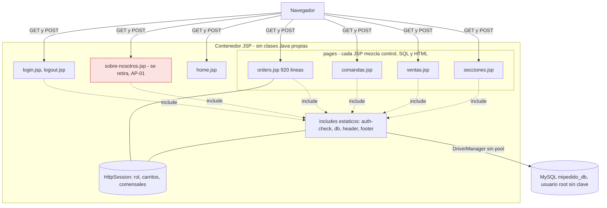
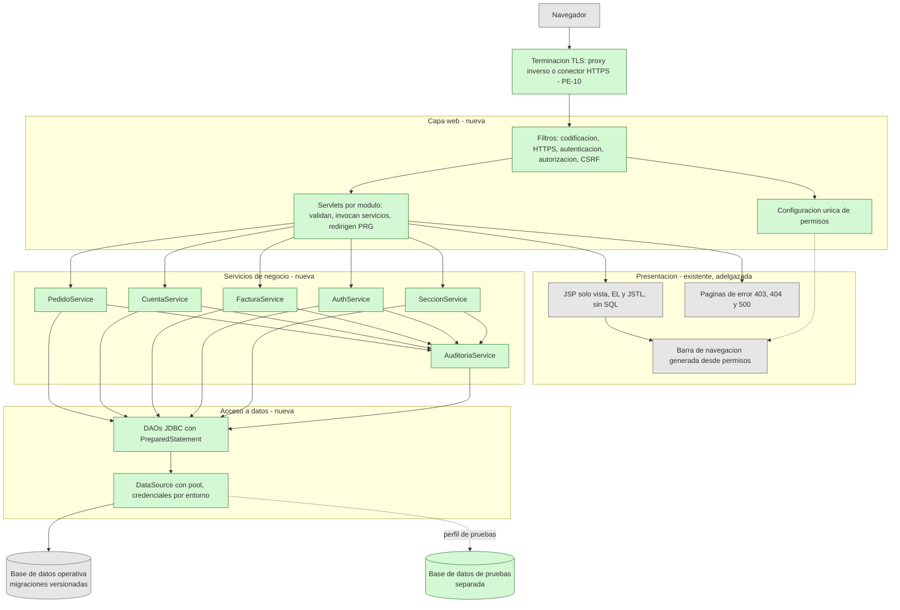
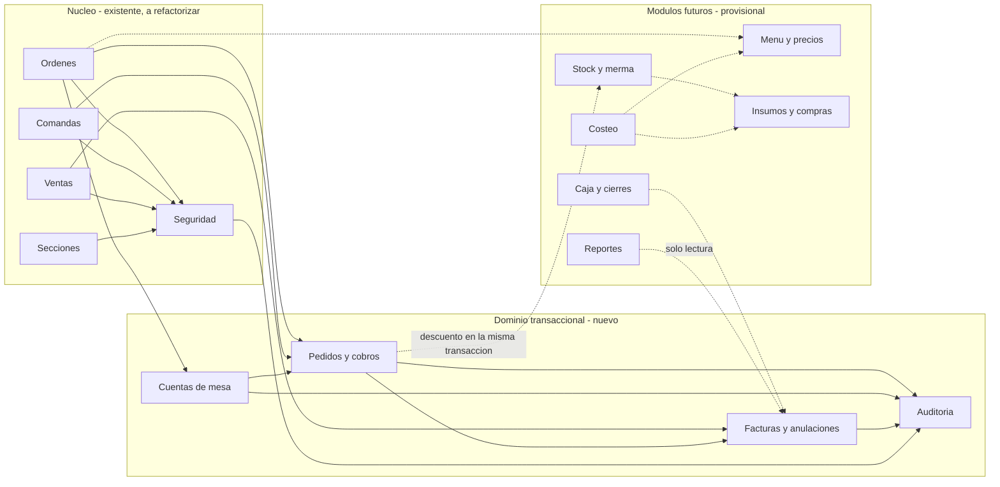
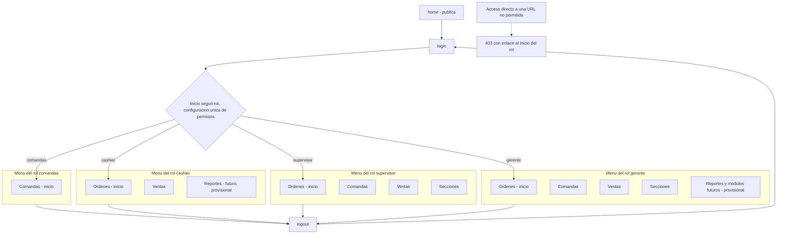
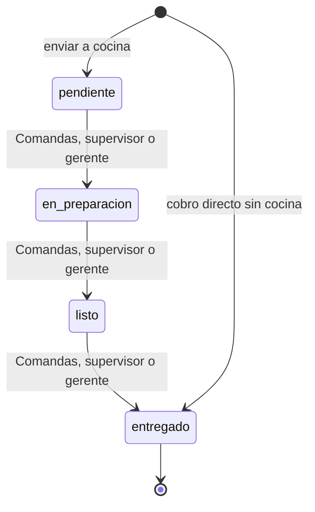
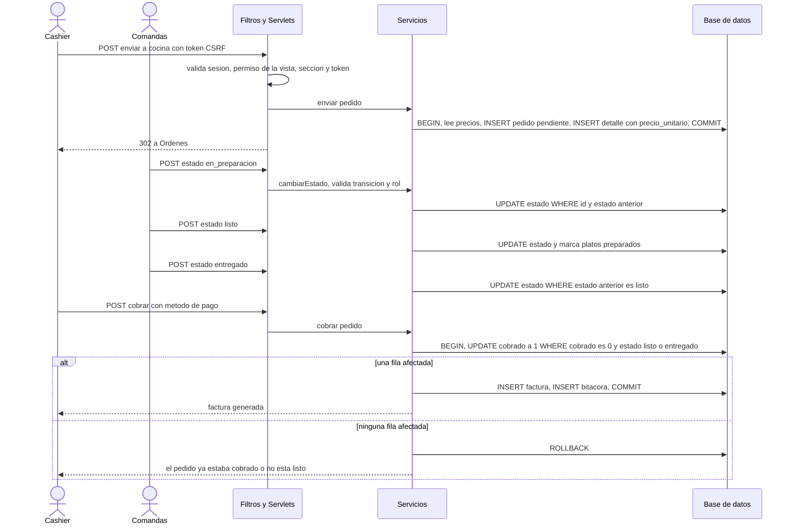
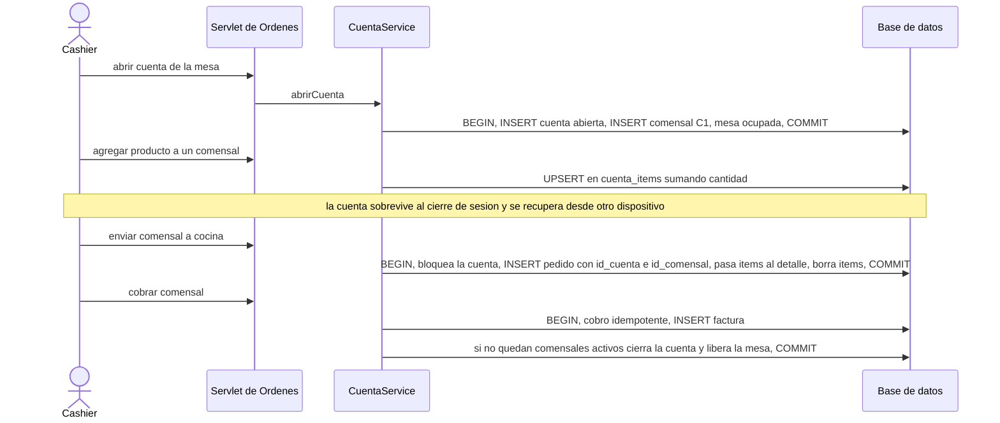
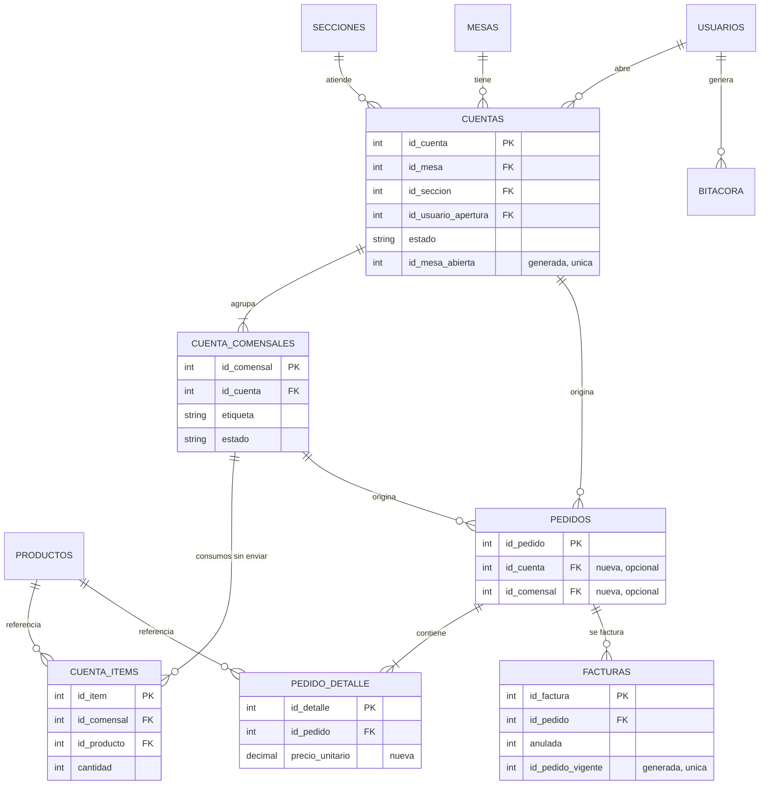
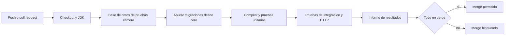
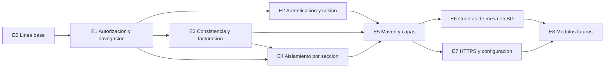

# Arquitectura del Software — Mi Pedido MaLu

| | |
|---|---|
| **Proyecto** | Mi Pedido MaLu — sistema de gestión de pedidos del Restaurante-Bar MaLu |
| **Versión documental** | 0.2 (borrador para revisión del propietario) |
| **Fecha** | 2026-10-14 |
| **Base analizada** | Repositorio `MaLu`, commit `bfbc18a`: `BASE-JSP_MiPedidoJSP/` y `MantSoftware/Proyecto/` |
| **Método** | Lectura estática del código. No se compiló ni se ejecutó el sistema |
| **Estado** | Diseño. **Ninguna mejora descrita aquí está implementada** |

## Convenciones

| Etiqueta | Significado |
|---|---|
| **[Comprobado]** | Verificado en el código del repositorio o en una fuente citada en la sección 15 |
| **[Aprobado]** | Decisión del propietario (`AP-xx`, sección 14.1) |
| **[Propuesta]** | Diseño recomendado, no implementado |
| **[Pendiente]** | Requiere una decisión (`PE-xx`, sección 14.2) o una prueba de ejecución |

Otros identificadores: `L-xx` limitaciones del sistema actual, `DC-xx` discrepancias entre el código actual y el diseño objetivo, `RI-xx` riesgos, `E0`–`E8` etapas de migración. Donde este documento difiera de entregables académicos anteriores (informe, wireframes), prevalecen las decisiones de la sección 14.

## Índice

- [1. Propósito, alcance y contexto](#1-propósito-alcance-y-contexto)
- [2. Sistema actual y limitaciones](#2-sistema-actual-y-limitaciones)
  - [2.1 Implementaciones existentes](#21-implementaciones-existentes)
  - [2.2 Arquitectura actual](#22-arquitectura-actual)
  - [2.3 Limitaciones relevantes](#23-limitaciones-relevantes)
- [3. Arquitectura objetivo](#3-arquitectura-objetivo)
  - [3.1 Principios](#31-principios)
  - [3.2 Plataforma y versiones](#32-plataforma-y-versiones)
  - [3.3 Arquitectura objetivo](#33-arquitectura-objetivo)
- [4. Estructura de carpetas y módulos](#4-estructura-de-carpetas-y-módulos)
  - [4.1 Estructura propuesta](#41-estructura-propuesta)
  - [4.2 Componentes y dependencias](#42-componentes-y-dependencias)
- [5. Roles, vistas y permisos](#5-roles-vistas-y-permisos)
  - [5.1 Estado actual [Comprobado]](#51-estado-actual-comprobado)
  - [5.2 Diseño objetivo [Aprobado]](#52-diseño-objetivo-aprobado)
  - [5.3 Discrepancias entre el código actual y el diseño objetivo](#53-discrepancias-entre-el-código-actual-y-el-diseño-objetivo)
- [6. Navegación](#6-navegación)
- [7. Flujos de negocio](#7-flujos-de-negocio)
  - [7.1 Estados del pedido y responsables [Aprobado, AP-20]](#71-estados-del-pedido-y-responsables-aprobado-ap-20)
  - [7.2 Pedido, comandas y cobro](#72-pedido-comandas-y-cobro)
  - [7.3 Cuentas de mesa abiertas](#73-cuentas-de-mesa-abiertas)
  - [7.4 Facturación, anulación e integridad](#74-facturación-anulación-e-integridad)
- [8. Persistencia de las cuentas abiertas [Propuesta]](#8-persistencia-de-las-cuentas-abiertas-propuesta)
- [9. Acceso a datos, transacciones y migraciones](#9-acceso-a-datos-transacciones-y-migraciones)
  - [9.1 Acceso a datos [Propuesta]](#91-acceso-a-datos-propuesta)
  - [9.2 Transacciones](#92-transacciones)
  - [9.3 Migraciones de esquema](#93-migraciones-de-esquema)
- [10. Seguridad, autorización, auditoría y protección de información](#10-seguridad-autorización-auditoría-y-protección-de-información)
  - [10.1 Autenticación y contraseñas (AP-14)](#101-autenticación-y-contraseñas-ap-14)
  - [10.2 Sesión](#102-sesión)
  - [10.3 Autorización](#103-autorización)
  - [10.4 Operaciones que modifican datos](#104-operaciones-que-modifican-datos)
  - [10.5 Auditoría](#105-auditoría)
  - [10.6 Protección de información](#106-protección-de-información)
- [11. Pruebas automatizadas e integración continua](#11-pruebas-automatizadas-e-integración-continua)
  - [11.1 Entornos](#111-entornos)
  - [11.2 Niveles de prueba](#112-niveles-de-prueba)
  - [11.3 Integración continua](#113-integración-continua)
- [12. Preparación para HTTPS y dominio futuro](#12-preparación-para-https-y-dominio-futuro)
- [13. Plan de migración gradual](#13-plan-de-migración-gradual)
- [14. Decisiones, pendientes y riesgos](#14-decisiones-pendientes-y-riesgos)
  - [14.1 Decisiones aprobadas](#141-decisiones-aprobadas)
  - [14.2 Decisiones pendientes](#142-decisiones-pendientes)
  - [14.3 Decisiones de diseño y alternativas descartadas](#143-decisiones-de-diseño-y-alternativas-descartadas)
  - [14.4 Riesgos conocidos](#144-riesgos-conocidos)
- [15. Referencias e historial](#15-referencias-e-historial)
  - [Fuentes de versiones (consultadas el 2026-10-13)](#fuentes-de-versiones-consultadas-el-2026-10-13)
  - [Archivos del repositorio citados](#archivos-del-repositorio-citados)
  - [Historial de cambios](#historial-de-cambios)

## 1. Propósito, alcance y contexto

**Propósito.** Servir como referencia técnica para corregir las deficiencias de Mi Pedido MaLu y evolucionarlo de forma ordenada, segura y mantenible.

**Alcance.** Arquitectura actual y objetivo, roles y permisos, flujos de negocio, persistencia de cuentas de mesa, seguridad, pruebas, preparación para HTTPS y plan de migración. Quedan fuera la implementación, el despliegue concreto y el detalle de los módulos futuros.

**Contexto.** El sistema gestiona pedidos de dos secciones operativas (Restaurante y Bar) con cuatro roles: gerente, supervisor, cashier y comandas (cocina). Los requisitos oficiales están en un documento de SharePoint de la UTP (`Requisitos.url`) que no pudo consultarse; el análisis se apoyó en el código, en el informe `BASE-JSP_MiPedidoJSP/Documentacion/` y en las decisiones del propietario.

## 2. Sistema actual y limitaciones

### 2.1 Implementaciones existentes

| | `BASE-JSP_MiPedidoJSP` | `MantSoftware/Proyecto` |
|---|---|---|
| Papel | Implementación principal (AP-18) | Versión PHP de comparación |
| Tecnología | JSP con scriptlets (Servlet 4.0 en `web.xml`), JDBC directo, `mysql-connector-j-9.7.0.jar` | PHP (la sintaxis exige 7.4 o superior), sin base de datos |
| Persistencia | Base `mipedido_db` (9 tablas, InnoDB, claves foráneas) | `$_SESSION['datos']`: cada navegador tiene sus propios datos |
| Tamaño | ~2.200 líneas JSP/SQL | ~2.200 líneas PHP |

Ambas comparten las vistas `login`, `home`, `orders`, `comandas`, `ventas` y `secciones`. La versión PHP no sirve como base porque su estado no se comparte entre usuarios ni dispositivos [Comprobado]. Se archiva con la etiqueta `legacy-php` y se retira de `main` (AP-19).

### 2.2 Arquitectura actual



### 2.3 Limitaciones relevantes

| ID | Limitación | Evidencia | Estado | Etapa |
|---|---|---|---|---|
| L-01 | Bucle de redirección del rol `comandas`: `auth-check` redirige a `pages/orders.jsp`, pero `orders`, `ventas` y `secciones` no admiten ese rol, y el menú muestra enlaces a todos | `includes/auth-check.jsp`, `rolesPermitidos` de cada página, `includes/header.jsp` | Comprobado en código; no reproducido | E1 |
| L-02 | Permisos repartidos en tres sitios (`rolesPermitidos`, `header.jsp`, `auth-check`) y sin filtro central: una página nueva sin el `include` queda abierta | Todas las páginas | Comprobado | E1 |
| L-03 | Contraseñas en texto plano comparadas en la consulta; credenciales de demostración en el repositorio | `sql/schema.sql`, `login.jsp`, `datos.php` | Comprobado | E2 |
| L-04 | Salidas HTML sin escape en JSP (ninguna función de escape en 127 usos de `<%=` en `pages/*.jsp`); datos de usuario como `nota` y nombres llegan a otras vistas | `pages/*.jsp` | Ausencia comprobada; explotación sin probar | E2 |
| L-05 | Sin protección CSRF en ningún POST | Búsqueda en el repositorio | Comprobado | E2 |
| L-06 | El inicio de sesión no renueva el identificador de sesión | `login.jsp` | Comprobado | E2 |
| L-07 | Conexión con `root` sin clave en el código; el mensaje de error de conexión se muestra en `login.jsp` | `includes/db.jsp`, `login.jsp` | Comprobado | E2 |
| L-08 | Sin autorización por objeto: `cobrarListo` lee la sección del pedido pero no la compara con la del usuario (solo la lista en pantalla filtra) y `ventas.jsp` no filtra por sección | `pages/orders.jsp:150-175` y `:402-406`, `pages/ventas.jsp` | Comprobado | E4 |
| L-09 | Cobro sin bloqueo ni unicidad: `cobrarListo` lee el pedido y después hace un `UPDATE` sin condición de `cobrado`; ningún `FOR UPDATE` en los JSP y `facturas` sin `UNIQUE(id_pedido)` | `pages/orders.jsp:150-175`, `sql/schema.sql` | Comprobado en código; doble cobro sin probar | E3 |
| L-10 | El precio no se congela: `pedido_detalle` no guarda precio y el detalle de factura lee `productos.precio` | `sql/schema.sql`, `pages/ventas.jsp:173-175` | Comprobado | E3 |
| L-11 | `setEstado` acepta cualquier estado y no hay validación de estado ni método de pago en código (solo el ENUM de la BD) | `pages/comandas.jsp`, `pages/orders.jsp` | Comprobado; efecto del `sql_mode` sin probar | E3 |
| L-12 | Las cuentas de mesa viven en la sesión (`carritosMesa`, `comensalesPorMesa`) mientras `mesas.estado` está en la BD; si se abandona el carrito la mesa queda ocupada | `pages/orders.jsp` | Comprobado | E6 |
| L-13 | SQL, reglas y HTML mezclados (`orders.jsp`, 920 líneas); 10 variables de conexión distintas en `orders.jsp` y sin pool; sin pruebas automatizadas, `.gitignore` ni CI | `pages/orders.jsp`, raíz del repositorio | Comprobado; cierre de cada conexión sin verificar | E0, E5 |
| L-14 | La vista pública «Sobre Nosotros» publica cédula, carrera y foto desde la tabla `usuarios` | `sobre-nosotros.jsp:41-56`, `sql/schema.sql:25-38` | Comprobado | E1 (AP-01) |
| L-15 | Comandas muestra pedidos de todas las secciones | `pages/comandas.jsp:99-101` | Comprobado; si es deseable, PE-09 | — |

## 3. Arquitectura objetivo

### 3.1 Principios

1. **Una sola fuente de permisos**, con denegación por defecto.
2. **La autorización se comprueba en el servidor**; la navegación solo refleja lo permitido.
3. **Los datos solo cambian mediante servicios transaccionales.**
4. **La base de datos es la fuente de verdad**: la sesión conserva únicamente la identidad del usuario.
5. **Evolución gradual**: cada etapa deja el sistema funcionando y se verifica contra pruebas de regresión.
6. **Sin complejidad innecesaria**: sin microservicios ni frameworks de aplicación (alternativas descartadas en 14.3).
7. **Configuración y secretos fuera del código.**

### 3.2 Plataforma y versiones

[Aprobado, AP-10] La arquitectura incorpora Maven, Servlets, servicios y DAO. Las versiones concretas **no están decididas** (PE-01). Datos verificados el 2026-10-13 (fuentes en la sección 15):

| Componente | Dato verificado | Implicación |
|---|---|---|
| Tomcat 9.0.x | Servlet 4.0, Java 8 o superior. Fin de soporte anunciado: **2027-03-31** | Es el que encaja con el `web.xml` actual, pero queda con ~5 meses de soporte |
| Tomcat 10.1.x | Jakarta Servlet 6.0, Java 11 o superior | Espacio de nombres `jakarta.*` |
| Tomcat 11.0.x | Jakarta Servlet 6.1, Java 17 o superior | Línea más reciente |
| Java | LTS vigentes: 8, 11, 17, 21 y 25 (Java 25 desde septiembre de 2025; próxima LTS planificada: 29, septiembre de 2027). Todas las líneas de Tomcat soportadas funcionan con Java 17 | Para código nuevo, JDK 17 o superior |
| Maven | La serie 3.9.x es la estable y requiere JDK 8 o superior; 4.0 requiere JDK 17 y figuraba como candidata en las páginas consultadas | Usar 3.9.x salvo que 4.0 sea estable al implementar |
| MySQL | 8.0 llegó a fin de vida el 2026-04-30. 8.4 LTS tiene soporte hasta abril de 2032; 9.7 LTS (GA el 2026-04-21, según fuente secundaria) | El motor y la versión del XAMPP del equipo **no están verificados** |
| Conector JDBC | El repositorio incluye `mysql-connector-j-9.7.0.jar` | Compatibilidad con el servidor elegido sin verificar |

**Análisis para PE-01.** Hoy no hay clases Java propias y ningún JSP importa `javax.*` [Comprobado]; solo el esquema de `web.xml` pertenece a Java EE 8. Por tanto, el código Java nuevo puede escribirse directamente contra `jakarta.*` sin migrar nada. **[Propuesta]** Plataforma objetivo: Tomcat 10.1.x u 11.0.x, JDK LTS 17 o superior, Maven 3.9.x y MySQL LTS (8.4 o 9.7) o una versión soportada de MariaDB, fijando las versiones de parche al implementar. Tomcat 9 solo como transición. Las etapas E1–E4 son JSP puro y no dependen de esta elección; se espera que los scriptlets funcionen también en Tomcat 10.1 y 11, **sin verificar por ejecución**.

### 3.3 Arquitectura objetivo

Verde: componente nuevo. Gris: existente, adelgazado.



| Capa | Responsabilidad | Regla |
|---|---|---|
| Filtros | Autenticación, autorización por URL, CSRF, HTTPS, codificación | Denegar por defecto; leen la configuración única de permisos |
| Servlets | Validar entrada, invocar servicios, redirigir (patrón PRG, que el sistema ya usa) | Sin SQL ni reglas de negocio |
| Servicios | Reglas, transiciones de estado, transacciones, auditoría | Única vía para modificar pedidos, cuentas y facturas |
| DAO | Consultas con `PreparedStatement` | Sin reglas de negocio ni transacciones propias |
| JSP | Presentación con EL/JSTL y escape de salida | Sin SQL ni scriptlets de negocio |

En las etapas E1–E4 los filtros, servicios y DAO existen como funciones compartidas en archivos `.jspf` (`includes/lib/`); pasan a clases Java en E5.

## 4. Estructura de carpetas y módulos

### 4.1 Estructura propuesta

[Aprobado, AP-19] El trabajo se realiza en `MiPedido.0.1/` (el destino indicado en el README), creado como copia de `BASE-JSP_MiPedidoJSP/` al cerrar E0. `BASE-JSP_MiPedidoJSP/` permanece intacto como línea base y `MantSoftware/` se archiva con la etiqueta `legacy-php` y se retira de `main`. Hasta iniciar la implementación no se mueve ni elimina nada. El paquete base Java está por confirmar.

```
MiPedido.0.1/
├─ pom.xml                      Maven, empaquetado WAR (AP-10)
├─ db/
│  ├─ migrations/               V001__baseline.sql, V002__... (sección 9.3)
│  └─ seed/                     datos de demostración, solo desarrollo y pruebas
├─ config/                      plantillas sin secretos: context.xml.example, env.example
├─ src/
│  ├─ main/
│  │  ├─ java/<paquete.base>/   (a confirmar)
│  │  │  ├─ web/                filtros y servlets
│  │  │  ├─ service/            reglas de negocio y transacciones
│  │  │  ├─ dao/                acceso a datos JDBC
│  │  │  ├─ model/              entidades y enumeraciones (Rol, EstadoPedido)
│  │  │  └─ security/           permisos, hash, CSRF, bloqueo de intentos
│  │  └─ webapp/
│  │     ├─ WEB-INF/            web.xml y vistas JSP no accesibles directamente
│  │     └─ css/, img/
│  └─ test/java/                pruebas unitarias y de integración
├─ tests/                       pruebas HTTP (matriz de acceso) y casos manuales
└─ .github/workflows/           integración continua (sección 11)
```

Durante E1–E4 la estructura de `MiPedido.0.1/` sigue siendo la heredada de la base (`pages/`, `includes/`) más `includes/lib/*.jspf`. Los archivos de la vista retirada por AP-01 (su JSP, su CSS, los enlaces de `header.jsp` y `footer.jsp`, y las imágenes del equipo si no las usa otra vista) se eliminan en E1 tras verificar sus referencias.

### 4.2 Componentes y dependencias



| Módulo | Responsabilidad | Escribe en | Estado |
|---|---|---|---|
| Seguridad | Autenticación, permisos, sesión, CSRF, bloqueo de intentos | `usuarios` | Existente (login) / nuevo |
| Pedidos y cobros | Crear pedidos, transiciones de estado, cobro idempotente | `pedidos`, `pedido_detalle` | Existente, a extraer |
| Cuentas de mesa | Cuentas, comensales y consumos abiertos | `cuentas`, `cuenta_comensales`, `cuenta_items`, `mesas` | Nuevo (AP-12) |
| Facturas y anulaciones | Facturación, anulación, integridad de importes | `facturas` | Existente / nuevo |
| Auditoría | Registro de eventos sensibles | `bitacora` | Nuevo |
| Órdenes, Comandas, Ventas | Interacción y vistas de cada actor | Nada directo: usan servicios | Existente |
| Secciones | Secciones, categorías y asignación de cashiers | `secciones`, `categorias`, `usuarios.id_seccion` | Existente |
| Módulos futuros | Menú y precios, stock y merma, insumos y compras, costeo, caja, reportes | Por definir | Provisional (sección 5.2) |

## 5. Roles, vistas y permisos

### 5.1 Estado actual [Comprobado]

Según `rolesPermitidos` de cada página y `includes/header.jsp` (idéntico en la versión PHP):

| Vista | gerente | supervisor | cashier | comandas |
|---|---|---|---|---|
| login, home | público | público | público | público |
| orders | ✔ | ✔ | ✔ | ✘ (bucle, L-01) |
| comandas (ver, tachar platos, cambiar estado) | ✔ | ✔ | ✔ | ✔ |
| ventas | ✔ | ✔ | ✔, todas las secciones | ✘ (bucle) |
| secciones | ✔ | ✔ | ✘ → orders | ✘ (bucle) |
| reportes | marcador no funcional | — | — | — |
| anulación de facturas | no existe | no existe | no existe | no existe |

Quien no tiene permiso es redirigido a `orders`. Tras iniciar sesión, `comandas` va a Comandas y el resto a Órdenes.

### 5.2 Diseño objetivo [Aprobado]

| Vista o función | Gerente | Supervisor | Cashier | Comandas |
|---|---|---|---|---|
| login, home (públicas) | ✔ | ✔ | ✔ | ✔ |
| Órdenes | ✔ | ✔ | ✔ | ✘ |
| Comandas: consultar y actualizar estados | ✔ | ✔ (mantiene el acceso actual) | ✘ | ✔ (su única vista funcional) |
| Ventas | ✔ | ✔ | ✔ | ✘ |
| Reportes (futuro) | ✔ | PE-03 | ✔, alcance provisional | ✘ |
| Secciones | ✔ | ✔ | ✘ | ✘ |
| Anular facturas | ✔ | ✔ | ✘ | ✘ |
| Usuarios y otras funciones administrativas (futuro) | ✔ provisional | PE-03 | ✘ salvo autorización expresa posterior | ✘ |
| Menú, stock, insumos, compras, costeo, merma y caja (futuro) | ✔ provisional | Provisional, sin definir | Provisional, sin definir; sin funciones administrativas por defecto | ✘ |

Notas:

- **Gerente** tiene acceso a todas las vistas y funcionalidades autorizadas, incluidas las de los demás perfiles.
- **Supervisor** conserva por ahora las funcionalidades que ya tiene. La diferenciación con el gerente se define más adelante (PE-03); este documento no afirma que sus permisos sean idénticos ni añade restricciones.
- **Reportes** hoy es solo un marcador visual para el gerente. Que el cashier acceda a Reportes y el supervisor no esté definido es una incoherencia señalada en PE-03.
- **Aislamiento por sección** (L-08): para Ventas y Reportes del cashier se propone limitar los datos a su sección; el alcance exacto se confirma en PE-08.
- **Sin sección asignada** (AP-11): gerente y supervisor siguen sin sección propia. Hoy `pages/orders.jsp:21` les aplica la sección 1 por omisión [Comprobado]; ese comportamiento no se altera (RI-06).

**Configuración única de permisos** [Propuesta]: una sola estructura de datos alimenta el filtro del servidor, la barra de navegación y la página de inicio. Ejemplo ilustrativo:

```
vista             roles permitidos
ordenes           gerente, supervisor, cashier
comandas          gerente, supervisor, comandas
ventas            gerente, supervisor, cashier
secciones         gerente, supervisor
facturas.anular   gerente, supervisor
reportes          (provisional: gerente, cashier; supervisor en PE-03)
inicio            comandas -> comandas ; resto -> ordenes
```

Para diferenciar supervisor y gerente más adelante bastará añadir o quitar roles en esta estructura, sin tocar filtros, menú ni vistas (AP-13).

### 5.3 Discrepancias entre el código actual y el diseño objetivo

| ID | Código actual | Diseño objetivo | Etapa |
|---|---|---|---|
| DC-01 | El cashier accede a Comandas | Sin acceso | E1 |
| DC-02 | `comandas` es redirigido en bucle desde Órdenes, Ventas y Secciones | Sin enlaces a vistas no permitidas; 403 en acceso directo | E1 |
| DC-03 | El menú muestra enlaces comunes a todo usuario autenticado | Solo las vistas permitidas al rol | E1 |
| DC-04 | Sin permiso se redirige a `orders` | Respuesta 403 | E1 |
| DC-05 | Existe la vista pública «Sobre Nosotros» | Eliminada (AP-01) | E1 |
| DC-06 | Cashier, supervisor y gerente cambian estados desde Comandas | Cambian estados Comandas, supervisor y gerente (AP-20) | E3 |
| DC-07 | No existe la anulación de facturas (la columna `anulada` nunca se escribe) | Gerente y supervisor, con auditoría | E3 |
| DC-08 | Ventas muestra todas las secciones al cashier | Limitado a su sección (PE-08) | E4 |
| DC-09 | No existe Reportes | Vista futura con permisos provisionales | E8 |

## 6. Navegación

Reglas [Aprobado]: (1) la barra muestra solo las vistas permitidas al rol (AP-02); (2) además, el servidor comprueba el permiso en cada petición, aunque no haya enlace; (3) la página inicial y la redirección tras el login dependen del rol y de la configuración única de permisos (AP-03); (4) el acceso directo a una vista no autorizada produce una respuesta 403 con un enlace al inicio del rol, sin redirecciones encadenadas (AP-04).



El menú del supervisor refleja solo lo que ya tiene (sección 5.2); sus futuras entradas dependen de PE-03.

## 7. Flujos de negocio

### 7.1 Estados del pedido y responsables [Aprobado, AP-20]

El estado de cocina (`estado`) y el pago (`cobrado`) son ciclos independientes. Como el cashier deja de acceder a Comandas (AP-06), los estados de preparación y entrega los actualiza Comandas (y gerente y supervisor), y el cashier solo cobra.



| Operación | Quién | Condición |
|---|---|---|
| pendiente → en_preparacion → listo → entregado | Comandas, supervisor, gerente | Solo hacia adelante; corregir o retroceder un estado queda para una decisión posterior (PE-13) |
| Cobrar un pedido enviado a cocina | Cashier, supervisor, gerente | `cobrado = 0` y estado `listo` o `entregado` |
| Cobro directo (pedido rápido o comensal sin envío) | Cashier, supervisor, gerente | El pedido nace `entregado` y `cobrado = 1`, como hoy |

Hoy el cobro de un pedido `listo` lo marca `entregado` y Comandas solo muestra pedidos hasta `listo`. Se aprobó la alternativa A (AP-20): Comandas muestra también los pedidos `listo` hasta entregarlos. La alternativa B, conservar el comportamiento actual, queda descartada.

### 7.2 Pedido, comandas y cobro



### 7.3 Cuentas de mesa abiertas

Las cuentas abiertas se guardan en la base de datos (AP-12), no en la sesión. El diseño de datos está en la sección 8.



### 7.4 Facturación, anulación e integridad

1. **Facturar** es cobrar. El total lo calcula el servidor con el `precio_unitario` guardado en el detalle; el cliente nunca aporta importes.
2. **Anular** (solo gerente y supervisor, AP-15): `FacturaService.anular(idFactura, motivo)` ejecuta en una transacción `UPDATE facturas SET anulada = 1, anulada_en, anulada_por, motivo ... WHERE id_factura = ? AND anulada = 0`. Si afecta una fila, registra la bitácora; si ninguna, informa «ya anulada».
3. **La factura es inmutable**: `total`, `metodo_pago` y detalle no se modifican; no existe borrado. El usuario de base de datos de la aplicación no tendrá permiso `DELETE` sobre `facturas`, `pedido_detalle` ni `bitacora`.
4. **Importes históricos**: el precio se congela en `pedido_detalle.precio_unitario` y el total en `facturas.total`. Para pedidos anteriores a la migración el precio inicial se rellena con el precio vigente, por lo que su histórico puede no coincidir con el real.
5. **Una factura vigente por pedido**: una columna generada `id_pedido_vigente` (igual a `id_pedido` mientras `anulada = 0`, nula en otro caso) con índice único impide doble cobro y permite refacturar tras una anulación.
6. **Ventas** excluye las anuladas (el filtro `anulada = 0` ya existe [Comprobado]); se propone mostrar el importe anulado en un total aparte.
7. [Pendiente PE-05] Efecto de anular sobre el pedido y sobre el stock futuro, motivo obligatorio, ventana temporal y refacturación.

## 8. Persistencia de las cuentas abiertas [Propuesta]



| Tabla | Cambio | Contenido principal |
|---|---|---|
| `cuentas` | Nueva | Mesa, sección efectiva, usuario que abre, estado (`abierta`, `cerrada`, `cancelada`), fechas. Columna generada `id_mesa_abierta` única: como máximo una cuenta abierta por mesa |
| `cuenta_comensales` | Nueva | Etiqueta (C1, C2…), estado (`activo`, `cobrado`, `cancelado`); único por cuenta y etiqueta |
| `cuenta_items` | Nueva | Consumos aún sin enviar: producto y cantidad (≥ 1); único por comensal y producto |
| `pedidos` | Modificada | `id_cuenta` e `id_comensal` opcionales. Se conservan `id_mesa` y `comensal` por compatibilidad |
| `pedido_detalle` | Modificada | `precio_unitario` (L-10) |
| `mesas` | Compatibilidad | `estado` pasa a ser derivado de las cuentas y se actualiza en la misma transacción; su retiro se decide después |

Las columnas generadas exigen una versión de MySQL o MariaDB que las admita; se verifica al elegir la plataforma (PE-01). Alternativa: bloquear la fila de `mesas` con `SELECT ... FOR UPDATE` al abrir.

**Invariantes** (se verifican con pruebas automatizadas):

- **I-01** La mesa está ocupada si y solo si tiene una cuenta abierta.
- **I-02** Un comensal `cobrado` no tiene consumos sin enviar ni pedidos sin cobrar.
- **I-03** La cuenta se cierra, y la mesa se libera, en la misma transacción que cobra al último comensal activo.
- **I-04** Enviar un comensal convierte sus consumos en un pedido y los borra de `cuenta_items` en una sola transacción.
- **I-05** Todo pedido de origen `mesa` pertenece a una cuenta.

**Concurrencia.** Las cantidades se cambian con actualizaciones atómicas (`cantidad = cantidad + ?`). Enviar, cobrar y cerrar bloquean primero la cuenta (`SELECT ... FOR UPDATE`) y luego sus comensales e ítems, siempre en ese orden para evitar interbloqueos.

**Recuperación.** La vista de mesas lee las cuentas abiertas de la base de datos; cualquier usuario con permiso sobre Órdenes puede continuarlas, sujeto a PE-06. La sesión conserva solo la identidad. Un supervisor o gerente puede cancelar una cuenta abandonada, con registro en la bitácora.

**Sección.** `cuentas.id_seccion` es la sección efectiva del usuario que la abre; para gerente y supervisor sin sección se mantiene el comportamiento actual (AP-11). Si una mesa puede compartirse entre Restaurante y Bar, el diseño de una cuenta por mesa debe ampliarse (PE-06).

## 9. Acceso a datos, transacciones y migraciones

### 9.1 Acceso a datos [Propuesta]

- `DataSource` con pool, configurado en el contenedor (JNDI) o por entorno, con un usuario de base de datos de mínimos privilegios en lugar de `root`.
- Una conexión por petición, cerrada con `try-with-resources`; ninguna vista abre conexiones.
- Solo `PreparedStatement`; la validación de entrada ocurre antes de llegar al DAO.
- Los DAO no controlan transacciones: el límite transaccional es el servicio.

### 9.2 Transacciones

| Operación | Alcance | Protección contra concurrencia |
|---|---|---|
| Enviar pedido | Una transacción: pedido, detalle, cuenta y stock futuro | — |
| Cambiar estado | Una sentencia `UPDATE` | Condicionada al estado anterior; se comprueban las filas afectadas |
| Cobrar | Una transacción: marcar cobrado, factura, bitácora | `UPDATE ... WHERE cobrado = 0` y factura vigente única |
| Anular factura | Una transacción: anulación y bitácora | `UPDATE ... WHERE anulada = 0` |
| Operaciones de cuenta | Una transacción por operación | `SELECT ... FOR UPDATE` sobre la cuenta (sección 8) |

Reglas: `autoCommit` desactivado, `rollback` ante cualquier fallo, aislamiento por defecto de InnoDB (REPEATABLE READ), y reintento acotado ante interbloqueo (SQLState 40001; número de reintentos y tiempo de espera por definir al implementar).

### 9.3 Migraciones de esquema

[Propuesta] Scripts SQL versionados en `db/migrations/` (`V001__baseline.sql`, `V002__...`), solo hacia adelante, aplicados una vez y registrados en una tabla `schema_version`. Cada migración se prueba en una copia y desde cero en integración continua. Las destructivas exigen copia de seguridad previa. La herramienta (script propio o Flyway) queda en PE-10. **Ninguna migración se ha ejecutado.**

| Versión | Contenido | Etapa | Precaución |
|---|---|---|---|
| V001 | Línea base: `sql/schema.sql` actual, sin datos de demostración | E0 | — |
| V002 | `usuarios`: retirar `cedula`, `carrera`, `resumen_dev` y `foto_url` (AP-01) | E1 | Irreversible; `cedula` es `NOT NULL`, por lo que el código y el seed se actualizan antes |
| V003 | `usuarios`: hash de contraseña, intentos fallidos y bloqueo | E2 | Migración del texto plano en el primer inicio correcto |
| V004 | `bitacora` | E2 | — |
| V005 | `facturas`: campos de anulación e índice único de factura vigente | E3 | Comprobar antes que no hay pedidos con dos facturas |
| V006 | `pedido_detalle.precio_unitario` | E3 | Relleno con el precio vigente (sección 7.4) |
| V007 | `cuentas`, `cuenta_comensales`, `cuenta_items`; `pedidos.id_cuenta` e `id_comensal` | E6 | Ensayar con cuentas abiertas existentes |

## 10. Seguridad, autorización, auditoría y protección de información

### 10.1 Autenticación y contraseñas (AP-14)

[Aprobado] Contraseñas protegidas con hash, control de intentos fallidos y protección de sesiones. [Pendiente PE-07] Parámetros por definir:

| Parámetro | Propuesta | Estado |
|---|---|---|
| Algoritmo | Hash con sal por usuario: PBKDF2-HMAC-SHA256 del JDK (sin dependencias) o bcrypt/Argon2id con librería una vez exista Maven | Pendiente |
| Costo (iteraciones o memoria) | Fijarlo contra la guía vigente de OWASP (Password Storage Cheat Sheet) al implementar y medir el tiempo de inicio de sesión en el servidor real | Pendiente de verificar |
| Longitud mínima y reglas | Definir según NIST SP 800-63B y OWASP ASVS; evitar reglas de composición arbitrarias | Pendiente |
| Contraseñas existentes | Re-hash en el primer inicio correcto y eliminación posterior del texto plano; las cuentas de demostración obligan a cambiar la contraseña | Propuesta |
| Intentos fallidos | Umbral, ventana y duración del bloqueo por cuenta (y por IP). Valor inicial sugerido: 5 intentos en 15 minutos y bloqueo temporal de 15 minutos | Pendiente |
| Desbloqueo y restablecimiento | Quién puede hacerlo (relacionado con PE-03) | Pendiente |
| Mensajes | Respuesta genérica ante credenciales inválidas o cuenta bloqueada; nunca el mensaje técnico de la excepción | Propuesta |

### 10.2 Sesión

[Propuesta] Renovar el identificador al iniciar sesión (`changeSessionId`), invalidar la sesión al salir, rastreo solo por cookie, y cookie con `HttpOnly`, `Secure` (producción) y `SameSite`. La expiración por inactividad actual es de 30 minutos (`web.xml`) [Comprobado]; la expiración absoluta queda en PE-07. Los atributos de cookie dependen de la versión de Tomcat elegida (PE-01).

### 10.3 Autorización

[Aprobado, AP-02 a AP-04] La autorización se comprueba en el servidor, no solo en el menú.

- Un filtro central lee la configuración única de permisos (sección 5.2) y **deniega por defecto** cualquier ruta no declarada.
- Los servicios añaden comprobaciones por objeto: sección en cobros, ventas y facturas (L-08) y rol en cambios de estado y anulaciones.
- La respuesta ante acceso no permitido es 403, sin redirecciones.
- La separación futura entre supervisor y gerente (AP-13) se resuelve en la configuración de permisos, sin cambiar el resto.

### 10.4 Operaciones que modifican datos

- Solo se aceptan por POST [Comprobado: las acciones actuales ya lo exigen]; token CSRF por sesión en cada formulario, validado en el filtro.
- Validación en el servidor: listas blancas para estados y método de pago, números con análisis seguro (entrada inválida produce 400 o un mensaje claro, no un error 500) y longitudes según el esquema.
- Escape de toda salida con datos de usuario (`<c:out>` o equivalente) (L-04).
- Errores: mensaje genérico al usuario y detalle en el registro del servidor; páginas de error 403, 404 y 500.

### 10.5 Auditoría

[Propuesta, AP-15] Tabla `bitacora` de solo inserción: fecha y hora, usuario, rol, acción, entidad, identificador, detalle y dirección IP.

| Eventos registrados | Detalle mínimo |
|---|---|
| Inicio de sesión correcto o fallido, bloqueo y desbloqueo | Usuario, IP |
| Cobro | Pedido, factura, método, importe |
| **Anulación de factura** | Factura, motivo, usuario |
| Cancelación de cuenta | Cuenta, usuario, motivo |
| Cambio de rol o sección, alta de usuario, restablecimiento de contraseña | Usuario afectado, usuario que actúa |

El período de retención se define en PE-07.

### 10.6 Protección de información

- **Minimización:** la eliminación de «Sobre Nosotros» (AP-01) retira la publicación de cédula, carrera y foto (L-14) y, con V002, esos datos de la base.
- **Datos de clientes:** el esquema actual no almacena datos de clientes [Comprobado].
- **Secretos:** credenciales y claves fuera del repositorio (plantillas `*.example`, variables de entorno o configuración del contenedor), `.gitignore` y sin credenciales de demostración en producción.
- **Principio de mínimo privilegio** para el usuario de base de datos (sin `root`, sin `DELETE` sobre tablas de facturación y bitácora).
- **Integridad de facturas:** sección 7.4.

## 11. Pruebas automatizadas e integración continua

### 11.1 Entornos

| Entorno | Base de datos | Uso |
|---|---|---|
| Desarrollo | Local, con datos de demostración | Trabajo diario |
| Pruebas | **Separada de la operativa** (nombre propio, creada desde cero a partir de las migraciones) | Pruebas automatizadas y CI; sin datos reales |
| Producción | Operativa | Configuración y secretos propios (sección 12) |

### 11.2 Niveles de prueba

| Nivel | Qué verifica | Desde |
|---|---|---|
| Matriz de acceso HTTP | 4 roles × todas las vistas: 200 o 403, sin bucles, menú coherente con los permisos | E0 |
| Seguridad HTTP | POST sin token rechazado, escape de salida, bloqueo por intentos, cambio de sesión al autenticarse | E2 |
| Concurrencia de datos | Doble cobro, doble anulación, doble envío, invariantes I-01 a I-05 | E3, E6 |
| Unitarias de servicios | Reglas de negocio, transiciones, cálculo de totales | E5 |
| Integración con base de datos | DAOs y servicios contra la base de pruebas; migraciones desde cero | E5 |
| Manuales | Casos de las «Pruebas de Calidad» del README sobre las pantallas | Continuo |

Antes de que exista Maven (E0–E4) las pruebas HTTP se ejecutan con una herramienta ligera por elegir (PE-10). Desde E5 se usan JUnit 5 y la herramienta de pruebas de integración que se seleccione; las versiones se fijan al implementar.

### 11.3 Integración continua

[Aprobado, AP-17] El repositorio está en GitHub (remoto `origin`), por lo que el flujo natural es GitHub Actions. La configuración concreta (imágenes, versiones de JDK y de MySQL, servicio de base de datos efímero o contenedores de prueba) depende de PE-01 y PE-10.



La rama `main` se protege exigiendo que la integración continua pase antes de fusionar.

## 12. Preparación para HTTPS y dominio futuro

[Aprobado, AP-16] No se compra ni configura un dominio ahora; el sistema debe poder desplegarse con HTTPS y un dominio propio sin cambios de código.

| Requisito | Diseño [Propuesta] | Estado |
|---|---|---|
| Terminación TLS | Proxy inverso (o conector HTTPS de Tomcat) delante de la aplicación | PE-10 |
| Certificados | Emisión y renovación automatizadas (por ejemplo ACME); en desarrollo, un certificado local | PE-10 |
| Redirección | En producción, HTTP redirige a HTTPS | Propuesta |
| Cookies | `Secure`, `HttpOnly` y `SameSite` en producción (sección 10.2) | Propuesta |
| Detrás de un proxy | La aplicación debe reconocer el esquema y la IP originales (cabeceras `X-Forwarded-*` configuradas en el contenedor) para que `Secure` y la bitácora sean correctos | Propuesta |
| HSTS | Solo en producción y una vez validado HTTPS | Propuesta |
| Dominio | Ningún nombre de host ni URL absoluta en el código: rutas relativas y una URL base configurable | Propuesta |
| Perfiles de configuración | `dev`, `test` y `prod` con valores y secretos separados (variables de entorno o contexto del contenedor); el mismo artefacto se despliega en los tres | Propuesta |
| Separación | Producción no usa datos ni credenciales de demostración | Propuesta |

## 13. Plan de migración gradual

Cada etapa deja el sistema funcionando. Esfuerzo relativo: S pequeño, M medio, L grande (sin estimar fechas). «Prioridad» remite a las siete prioridades del rediseño: 1 autorización y bucle, 2 autenticación y sesiones, 3 consistencia de pedidos y facturas, 4 acceso entre secciones y roles, 5 separación de capas, 6 módulos futuros, 7 pruebas y control de versiones.



| Etapa | Prior. | Alcance | Depende de | Esf. | Criterios de aceptación |
|---|---|---|---|---|---|
| **E0** Línea base y entorno | 7 | `.gitignore`; ramas y etiqueta `v0.0-base`; crear `MiPedido.0.1/` como copia de la base y archivar `MantSoftware/` con la etiqueta `legacy-php` antes de retirarlo de `main` (AP-19, con autorización expresa al iniciar la implementación); base de datos de pruebas separada cargada desde V001 y datos de demostración; reproducir o descartar L-01, L-04, el efecto del `sql_mode` y el doble cobro (L-09); pruebas HTTP de la matriz de acceso y casos manuales del comportamiento actual | — | S | La aplicación arranca desde cero con instrucciones escritas y `MiPedido.0.1/` se comporta igual que la base; la etiqueta `legacy-php` existe antes de retirar `MantSoftware/`; las pruebas existen y fallan exactamente en DC-01 a DC-04; cada hallazgo queda reproducido o descartado con evidencia |
| **E1** Autorización, navegación y retiro de «Sobre Nosotros» | 1 | Configuración única de permisos; filtro central con denegación por defecto; 403; inicio por rol; menú generado desde permisos; roles según 5.2 (AP-05 a AP-08); eliminar la vista de AP-01 con sus enlaces y la migración V002; revisar referencias a las imágenes antes de borrarlas | E0 | S–M | La matriz de acceso automatizada coincide con 5.2 para los 4 roles y todas las vistas; ninguna cadena de redirecciones; el cashier no accede a Comandas; el menú de cada rol solo muestra vistas permitidas; no quedan referencias a la vista retirada en código ni en esta documentación; V002 aplicada sin errores en una copia |
| **E2** Autenticación, sesión y operaciones que modifican datos | 2 | Política de contraseñas (AP-14): hash, migración y bloqueo; renovación de sesión y cookies; CSRF; escape de salida; errores genéricos; usuario de BD de mínimos privilegios y pool; secretos fuera del repositorio; bitácora de seguridad (V003, V004) | E1 | M | Ninguna contraseña en texto plano tras la migración; POST sin token rechazado con 403; carga XSS inerte en `nota` y nombres; el identificador de sesión cambia al autenticarse; bloqueo tras el umbral; ni `root` ni credenciales en el repositorio |
| **E3** Consistencia de pedidos, cobros y facturas | 3 | Transiciones y responsables de estado (AP-20); cobro idempotente y factura vigente única; `precio_unitario`; validación en servidor de estado y método de pago; anulación por gerente y supervisor con auditoría (AP-15) (V005, V006) | E1; E2 para la bitácora | M | Dos cobros simultáneos generan una sola factura; una segunda anulación se rechaza; estados y métodos inválidos se rechazan; el total de cada factura iguala la suma de su detalle; la anulación registra motivo y usuario; cashier y comandas no pueden anular |
| **E4** Aislamiento por sección y rol | 4 | Comprobaciones de objeto en el servidor para cobro, ventas y facturas; alcance de Ventas del cashier (PE-08) | E1, E3 | S–M | Un cashier de una sección no ve ni cobra datos de otra (prueba automatizada); gerente y supervisor sin sección conservan su comportamiento actual (AP-11) |
| **E5** Maven, servlets, servicios y DAO | 5, 7 | Decidir la plataforma (PE-01); proyecto Maven; filtros, servlets, servicios y DAO; migrar primero `orders` y luego comandas, ventas y secciones; integración continua (AP-17) | E2, E3, E4; PE-01 | L | Las vistas no contienen SQL ni scriptlets de negocio; las pruebas unitarias y de integración pasan en CI; paridad con las pruebas HTTP de E0 a E4; `main` protegido con CI obligatorio |
| **E6** Cuentas de mesa persistentes | 3, 5 | Tablas de la sección 8 (V007); `CuentaService`; recuperación entre sesiones; cancelación de cuentas abandonadas (PE-06) | E5 | M–L | Una cuenta abierta se recupera tras cerrar sesión y desde otro navegador; nunca coexisten dos cuentas abiertas en una mesa; I-01 a I-05 verificadas por pruebas; no quedan carritos de mesa en la sesión |
| **E7** Despliegue seguro y configuración | 2 | Perfiles `dev`/`test`/`prod`; cookies `Secure`; redirección a HTTPS; cabeceras de proxy; HSTS; plantillas de configuración (sección 12) | E2, E5; PE-10 | S–M | En producción las cookies de sesión llevan `Secure`, `HttpOnly` y `SameSite`; HTTP redirige a HTTPS; el mismo artefacto se despliega en cada entorno cambiando solo la configuración; sin nombres de host en el código |
| **E8** Módulos futuros | 6 | Uno por uno, cada uno con su migración, permisos en la configuración única y pruebas: menú y precios, stock y merma, insumos y compras, costeo, caja y reportes | E5; E6 para stock | L cada uno | Cada módulo declara sus permisos en la configuración única, incluye pruebas y actualiza este documento |

Cambios de comportamiento aprobados que introduce el plan: el cashier pierde el acceso a Comandas (E1, DC-01), desaparece la vista «Sobre Nosotros» (E1) y se añade la anulación de facturas (E3).

## 14. Decisiones, pendientes y riesgos

### 14.1 Decisiones aprobadas

| ID | Decisión | Dónde se refleja |
|---|---|---|
| AP-01 | Eliminar la vista «Sobre Nosotros», sus referencias y sus datos asociados | 2.3, 9.3, 10.6, 13 (E1) |
| AP-02 | La navegación solo muestra vistas permitidas y la autorización se comprueba en el servidor | 5, 6, 10.3 |
| AP-03 | Inicio y redirección tras el login según el rol, con una única configuración de permisos | 5.2, 6 |
| AP-04 | Acceso directo no autorizado: respuesta 403, sin bucles | 6, 10.3 |
| AP-05 | Rol `comandas`: única vista funcional Comandas; consulta y actualiza estados; sin acceso a Órdenes, Ventas, Reportes ni vistas administrativas | 5.2, 7.1 |
| AP-06 | Cashier: Órdenes, Ventas y Reportes; sin Comandas ni administración de secciones, usuarios u otras funciones administrativas salvo autorización posterior | 5.2 |
| AP-07 | Gerente: todas las vistas y funcionalidades autorizadas; puede anular facturas | 5.2, 7.4 |
| AP-08 | Supervisor: mantiene el acceso actual; puede anular facturas; la diferenciación con el gerente se define después | 5.2 |
| AP-09 | Permisos de funcionalidades futuras: provisionales hasta definirlos | 5.2 |
| AP-10 | Maven, Servlets, servicios y DAO, con migración gradual que preserve las funcionalidades | 3, 4, 13 |
| AP-11 | Gerente y supervisor siguen sin sección asignada, sin alterar el comportamiento actual | 5.2, 8 |
| AP-12 | Las cuentas de mesa abiertas se persisten en la base de datos | 7.3, 8 |
| AP-13 | La diferenciación de permisos entre gerente y supervisor queda para una etapa posterior; la arquitectura debe admitirla sin reestructurar | 5.2, 10.3 |
| AP-14 | Política de seguridad: contraseñas con hash, control de intentos fallidos y protección de sesiones | 10.1, 10.2 |
| AP-15 | Solo gerente y supervisor anulan facturas, con auditoría e integridad de importes históricos | 7.4, 10.5 |
| AP-16 | Preparar el despliegue con HTTPS y un dominio propio futuro | 12 |
| AP-17 | Base de datos de pruebas separada e integración continua | 11 |
| AP-18 | `BASE-JSP_MiPedidoJSP` es la implementación principal (propuesta de la Fase 3, sujeta a que el diseño la confirmara; el diseño la confirma) | 2.1 |
| AP-19 | (PE-02) Directorio de trabajo `MiPedido.0.1/`, copia de la base al cerrar E0; `BASE-JSP_MiPedidoJSP/` queda intacto como línea base; `MantSoftware/` se archiva con la etiqueta `legacy-php` y se retira de `main`, con autorización expresa al iniciar la implementación | 4.1, 13 (E0) |
| AP-20 | (PE-04) Alternativa A: el estado de cocina y el cobro son independientes; Comandas, supervisor y gerente actualizan estados hasta `entregado`; Comandas muestra también los pedidos `listo`; solo hacia adelante; cobro con estado `listo` o `entregado` | 5.3, 7.1, 7.2, 13 (E3) |

### 14.2 Decisiones pendientes

| ID | Decisión pendiente | Efecto |
|---|---|---|
| PE-01 | Versiones de Java, Tomcat, Maven y motor de base de datos (sección 3.2), incluido el motor del XAMPP del equipo y la compatibilidad del conector | Bloquea E5 y E7 |
| PE-03 | Diferenciación entre supervisor y gerente: Reportes, usuarios, desbloqueo y restablecimiento de contraseñas, límites | AP-08, AP-13; 5.2 |
| PE-05 | Anulación: efecto sobre el pedido y el stock futuro, motivo obligatorio, ventana temporal y refacturación | E3 |
| PE-06 | Cuentas: mesa compartida entre secciones, usuarios sin sección, y tiempo y responsable de cancelar cuentas abandonadas | E6 |
| PE-07 | Parámetros de seguridad: algoritmo y costo del hash, longitud mínima, umbral y duración del bloqueo, expiración absoluta de sesión, retención de la bitácora | E2 |
| PE-08 | Alcance por sección de Ventas y Reportes del cashier, y contenido de Reportes | E4, E8 |
| PE-09 | Comandas: pantalla global o por sección (hoy muestra todas, L-15) | E3 |
| PE-10 | Infraestructura: terminación TLS y certificados, hosting, ejecución de CI y base de datos de pruebas, herramienta de pruebas HTTP, herramienta de migraciones | E0, E5, E7 |
| PE-11 | Vigencia y contenido de la página pública `home` | E1 |
| PE-12 | Pruebas de ejecución: reproducir L-01, la explotación de L-04, el efecto del `sql_mode` (L-11) y el doble cobro (L-09) | E0 |
| PE-13 | Cancelación de pedidos no cobrados y excepciones a la regla «solo hacia adelante» de AP-20 (por ejemplo, corrección de un estado por supervisor o gerente) | E3 |

### 14.3 Decisiones de diseño y alternativas descartadas

| Decisión | Alternativas descartadas | Justificación |
|---|---|---|
| Servlets, servicios y DAO sin framework (AP-10) | Spring MVC u otro framework de aplicación; mantener solo scriptlets | El framework obliga a reescribir casi todas las vistas y no se justifica por el tamaño actual; los scriptlets impiden probar la lógica de forma automática. Revisable si el sistema crece mucho |
| Una sola tabla de permisos con filtro central | Permisos por página (estado actual) | Es la causa de L-01 y L-02 |
| Pool de conexiones del contenedor | `DriverManager` por consulta (actual) | Viene con el contenedor; sin dependencias nuevas |
| Transacción por operación y cobro idempotente | Solo `autoCommit` | Evita el doble cobro (L-09) |
| Precio congelado en el detalle | Leer siempre el precio vigente | Imprescindible para precios, costeo e integridad histórica (L-10) |
| Migraciones SQL versionadas | Un único `schema.sql` | Permite evolucionar el esquema con trazabilidad |
| Mantener la actualización automática de Comandas cada 6 s | WebSocket o SSE | Suficiente para un local pequeño; sin cambios de infraestructura |
| BASE-JSP como base (AP-18) | PHP como base; reconstrucción desde cero | Única con persistencia compartida; el objetivo no es reconstruir |

### 14.4 Riesgos conocidos

| ID | Riesgo | Mitigación |
|---|---|---|
| RI-01 | Tomcat 9.0.x termina su soporte el 2027-03-31 [Comprobado] | Decidir la plataforma (PE-01) antes de E5; preferir una línea Jakarta |
| RI-02 | MySQL 8.0 llegó a fin de vida el 2026-04-30; el motor del equipo no está verificado | Verificar la versión y usar una LTS soportada o MariaDB soportada |
| RI-03 | Regresiones al refactorizar `orders.jsp` (920 líneas) | Pruebas de E0 previas; migrar vista por vista |
| RI-04 | Pérdida de datos en migraciones destructivas (V002), re-hash de contraseñas y relleno de precios (V006) | Copia de seguridad, ensayo en copia y migraciones solo hacia adelante |
| RI-05 | El cashier pierde Comandas: si no existe un usuario con rol `comandas` operativo, nadie actualiza estados | Asegurar el usuario de cocina antes de E1; Comandas actualiza los estados (AP-20) |
| RI-06 | La sección 1 por omisión de gerente y supervisor (AP-11) depende de que exista y sea la esperada | Documentado; se revisa en PE-06 |
| RI-07 | Conocimientos del equipo sobre Servlets y Maven sin verificar | Empezar por una vista pequeña y documentar el flujo de trabajo |
| RI-08 | Compatibilidad sin verificar entre el conector 9.7.0 y el servidor elegido, y entre los JSP y Tomcat 10.1 u 11 | Probar en E0 y E5 |
| RI-09 | Credenciales y datos de demostración permanecen en el historial público de Git | No usar esas credenciales en producción; la reescritura del historial no está planificada |
| RI-10 | Alcance amplio de los módulos futuros | Un módulo cada vez, con migración, permisos y pruebas propios |

## 15. Referencias e historial

### Fuentes de versiones (consultadas el 2026-10-13)

- Apache Tomcat, fin de soporte de 9.0.x: <https://tomcat.apache.org/tomcat-9.0.x-eos.html>
- Apache Tomcat, migración entre versiones: <https://tomcat.apache.org/migration.html> y <https://tomcat.apache.org/migration-11.0.html>
- Apache Tomcat, versiones y especificaciones: <https://tomcat.apache.org/whichversion.html>
- Apache Maven, descarga y requisitos: <https://maven.apache.org/download.cgi>
- Oracle, hoja de ruta de Java SE: <https://www.oracle.com/technetwork/es/java/java-se-support-roadmap.html>
- Oracle, fin de vida de MySQL 8.0: <https://blogs.oracle.com/mysql/post/endoflife-of-heatwave-mysql-80-version>; fecha confirmada también en <https://www.openlogic.com/blog/mysql-8-end-of-life>
- MySQL 9.7 LTS (fuente secundaria, a verificar en Oracle): <https://medhacloud.com/blog/mysql-versions>

### Archivos del repositorio citados

- [README](../README.md)
- [`web.xml`](../BASE-JSP_MiPedidoJSP/WEB-INF/web.xml)
- [`schema.sql`](../BASE-JSP_MiPedidoJSP/sql/schema.sql)
- [`auth-check.jsp`](../BASE-JSP_MiPedidoJSP/includes/auth-check.jsp)
- [`header.jsp`](../BASE-JSP_MiPedidoJSP/includes/header.jsp)
- [`orders.jsp`](../BASE-JSP_MiPedidoJSP/pages/orders.jsp)
- [`comandas.jsp`](../BASE-JSP_MiPedidoJSP/pages/comandas.jsp)
- [`ventas.jsp`](../BASE-JSP_MiPedidoJSP/pages/ventas.jsp)

### Historial de cambios

| Versión | Fecha | Cambios |
|---|---|---|
| 0.1 | 2026-10-13 | Primera versión: análisis del sistema actual, arquitectura objetivo, decisiones aprobadas de la Fase 4 y plan de migración |
| 0.2 | 2026-10-14 | PE-02 y PE-04 pasan a decisiones aprobadas (AP-19, AP-20); se abre PE-13 para lo que PE-04 no resolvía |
